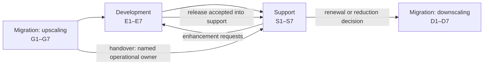

# Adobe commerce

**Consultant-led handbooks for the full Adobe Digital Experience Platform (DXP) lifecycle: migrate it, build on it, and run it.**

This repository is a practical methodology library for consultants, technical leads, architects, project managers and client IT teams working with Adobe Experience Manager (AEM), Adobe Commerce, Adobe Experience Platform (AEP) and the related Experience Cloud modules.

Each handbook follows the same pattern: a seven-phase lifecycle, approval gates with required evidence, deliverables per phase, templates, checklists, Mermaid diagrams, and a hard rule that **the consultant exits only when the client has a named operational owner**.

> **Status:** Product statements are indicative and follow the *verify* convention (see [Shared conventions](#shared-conventions)). Nothing here is legal advice.

---

## Repository map

```
adobe/
├── README.md                  ← you are here
├── migration/
│   ├── README.md              Which migration handbook to use
│   ├── upscaling/             Existing platforms → Adobe DXP        (gates G1–G7)
│   └── downscaling/           Adobe DXP → WooCommerce / PrestaShop /
│                              Shopify / custom platform             (gates D1–D7)
├── development/               Building and changing solutions on Adobe DXP  (gates E1–E7)
└── support/                   Running and supporting Adobe DXP             (gates S1–S7)
```

## How the handbooks connect



---

## 1. Migration

Migration is the first and most mature part of the library. It has two directions, each a complete seven-phase handbook.

### 1.1 Upscaling: existing platforms → Adobe DXP

[`migration/upscaling/`](migration/upscaling/README.md) — *Enterprise Adobe DXP Migration Handbook v1.1*

For organisations moving from custom portals, WooCommerce, PrestaShop, Shopify, existing Adobe Commerce or legacy CMS platforms into Adobe DXP.

| Phase | Outcome | Gate |
|---|---|---|
| 1 Discovery | Current business and technology landscape understood | G1 |
| 2 Assessment and Strategy | Migration approach, hosting decision per product, business case | G2 |
| 3 Design | Target architecture and solution design | G3 |
| 4 Build and Development | Environments, configuration, middleware, migration tooling | G4 |
| 5 Content and Data Migration | Rehearsed, reconciled migration | G5 |
| 6 Testing and Cutover | Validated go-live | G6 |
| 7 Hypercare, Support and Handover | Stable platform, named operational owner, closure | G7 |

Highlights: AEM, Adobe Commerce and AEP as principal products; per-product deployment decision matrices; POPIA and data-residency checks; engagement models and RACI; source-platform notes; 11 templates, checklists and diagrams.

### 1.2 Downscaling: Adobe DXP → WooCommerce, PrestaShop, Shopify or a custom platform

[`migration/downscaling/`](migration/downscaling/README.md) — *Adobe DXP Downscale Playbook v1.0*

For organisations leaving Adobe DXP for a simpler, lower-cost or better-fitting platform.

| Phase | Outcome | Gate |
|---|---|---|
| 1 Exit Discovery and Entitlement Review | Estate, extraction entitlement and Adobe contract clock understood | D1 |
| 2 Target Selection and Strategy | Target chosen, capability losses signed off | D2 |
| 3 Design | Target architecture, data mapping, URL and SEO design | D3 |
| 4 Build and Configuration | Target platform, integrations, tooling ready | D4 |
| 5 Extraction and Data Migration | Export, load, rehearse, reconcile, archive | D5 |
| 6 Testing and Cutover | Validated cutover with an Adobe fallback window | D6 |
| 7 Hypercare, Handover and Adobe Decommissioning | Stable platform, clean Adobe exit with evidence | D7 |

Highlights: contract and notice-date planning; capability loss register; individual playbooks for WooCommerce, PrestaShop, Shopify and custom builds; cross-platform entity mapping; SEO and redirect design; formal decommissioning.

Start with [`migration/README.md`](migration/README.md) if you are unsure which direction applies.

---

## 2. Development

[`development/`](development/README.md) — *Enterprise Adobe DXP Development Handbook v1.0*

An engineering lifecycle for designing, building, testing, releasing and handing over custom solutions on AEM, Adobe Commerce, AEP and the Experience Cloud modules. Built the same way as the migration handbooks.

| Phase | Outcome | Gate |
|---|---|---|
| 1 Requirements and Technical Discovery | Prioritised, testable requirements and NFRs | E1 |
| 2 Architecture and Technical Design | Approved design, ADRs, supported extension points | E2 |
| 3 Foundations | Environments, repositories, pipelines and standards | E3 |
| 4 Implementation | Reviewed, tested increments with product-specific guides | E4 |
| 5 Quality Engineering | Functional, performance, security and accessibility evidence | E5 |
| 6 Release and Deployment | Controlled, reversible production release | E6 |
| 7 Stabilisation and Developer Handover | Stable release and a client team able to continue | E7 |

Highlights: upgrade-safe, supported-extension-point rule; AEM, Commerce, AEP and Experience Cloud implementation guides; cross-cutting engineering standards; definition of done; CI/CD reference pipeline; technical debt management.

---

## 3. Support

[`support/`](support/README.md) — *Enterprise Adobe DXP Support and Operations Handbook v1.0*

A service lifecycle for designing, transitioning in, running and continually improving support for an Adobe DXP estate. Built the same way as the migration handbooks.

| Phase | Outcome | Gate |
|---|---|---|
| 1 Service Discovery and Assessment | Estate, risks and expectations understood | S1 |
| 2 Service Design | Catalogue, SLAs, processes, tooling and monitoring agreed | S2 |
| 3 Transition-In | Runbooks, access, training and shadow period completed | S3 |
| 4 Live Operations | Incident, problem, change, security and backup operations | S4 |
| 5 Service Management and Continual Improvement | KPIs, reviews, capacity, improvement | S5 |
| 6 Platform Lifecycle and Upgrade Management | Controlled response to releases, patches and end-of-support | S6 |
| 7 Service Review, Renewal or Transition-Out | Clean renewal or handback | S7 |

Highlights: shared-responsibility matrix across Adobe, host, MSP and client; L1–L3 tiers; severity and SLA design; major incident procedure; per-product daily, weekly and monthly operations for AEM, Commerce, AEP, Experience Cloud and integrations; vendor escalation with evidence.

---

## Shared conventions

| Convention | Applies to | Summary |
|---|---|---|
| **Gate prefixes** | All | G = up-scale migration, D = downscale migration, E = development, S = support |
| **Engagement models** | All | A: consultant-led or consultant-provided; B: lead-and-assure (default); C: advisory only. Named in the SoW. |
| **Operational-owner exit rule** | All | The consultant cannot formally exit until the client has a named, accountable owner (internal team, MSP or partner), with a defined fallback (time-boxed extension or signed risk acceptance). |
| **Verify convention** | All | Adobe product facts are indicative. Re-verify against current Adobe documentation and the client's licence before design approval, with a *Last verified* date. |
| **Client ownership** | All | The client owns data, accounts, vendor relationships, code, documentation and operations. |
| **Templates, checklists, diagrams** | All | Each handbook has its own `templates/`, `checklists/` and `diagrams/` folders with Mermaid diagrams that render on GitHub. |

---

## Who prepared it
[Regis Tembachako](https://github.com/ReggieTe/ReggieTe)  

---

## Using this repository

- **Browse on GitHub:** each folder's `README.md` has a section map and links to the files.
- **Adopt and adapt:** copy the templates and checklists into your own engagement workspace.
- **Contribute or correct:** raise an issue or pull request. Product facts especially benefit from review against current Adobe documentation.

