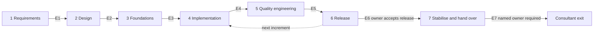
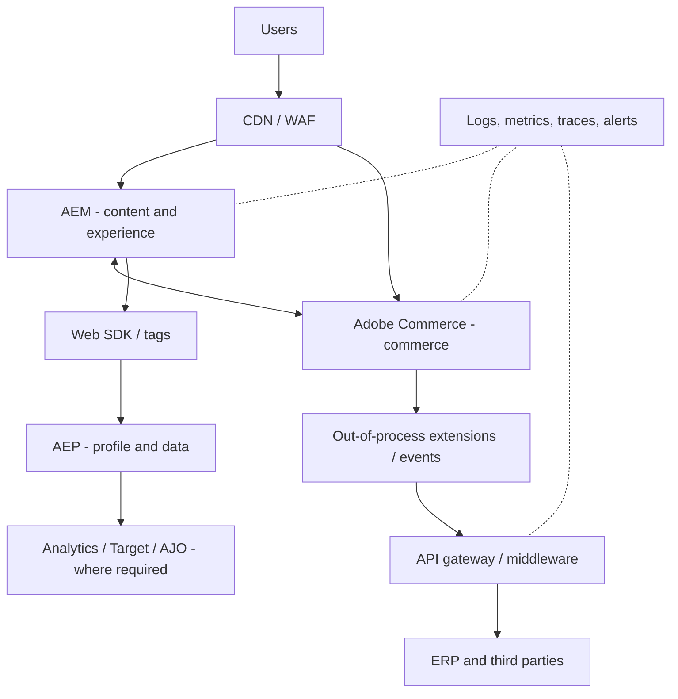
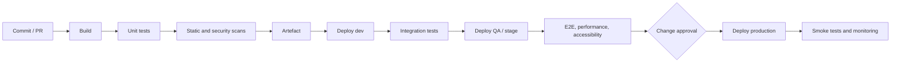

# Reference Diagrams (Mermaid)

> Part of the *Enterprise Adobe DXP Development Handbook* v1.0 (Review Draft). Section numbers (§) refer to the handbook's original numbering; see the README at the root of this folder for the section map.

## C.1 Lifecycle and gates

## C.2 Solution architecture (illustrative)

## C.3 CI/CD pipeline

---

**End of Handbook – Version 1.0 Review Draft**
