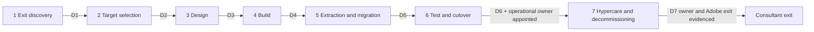
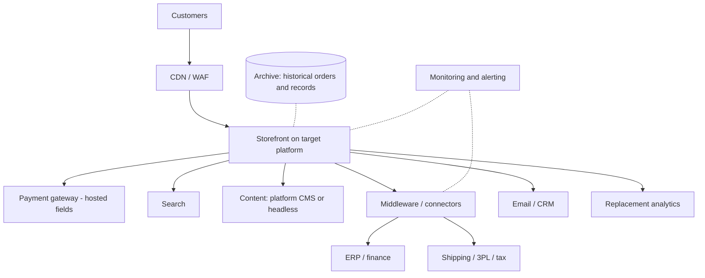
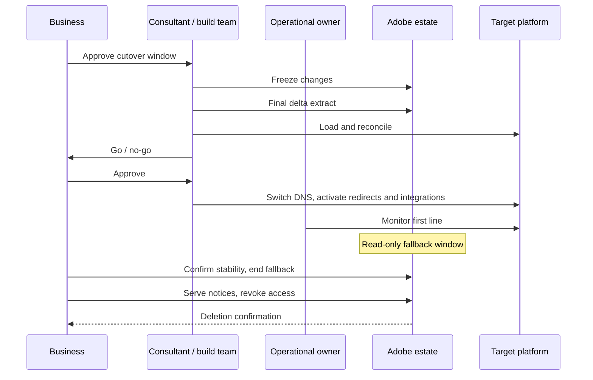

# Reference Diagrams (Mermaid)

> Part of the *Adobe DXP Downscale Playbook* v1.0 (Review Draft). Section numbers (§) refer to the playbook's original numbering; see the root [README](../README.md) for the section map.

## C.1 Lifecycle and gates

## C.2 Target architecture (illustrative)

## C.3 Cutover and decommissioning sequence

---

**End of Playbook – Version 1.0 Review Draft**
