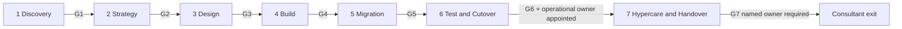
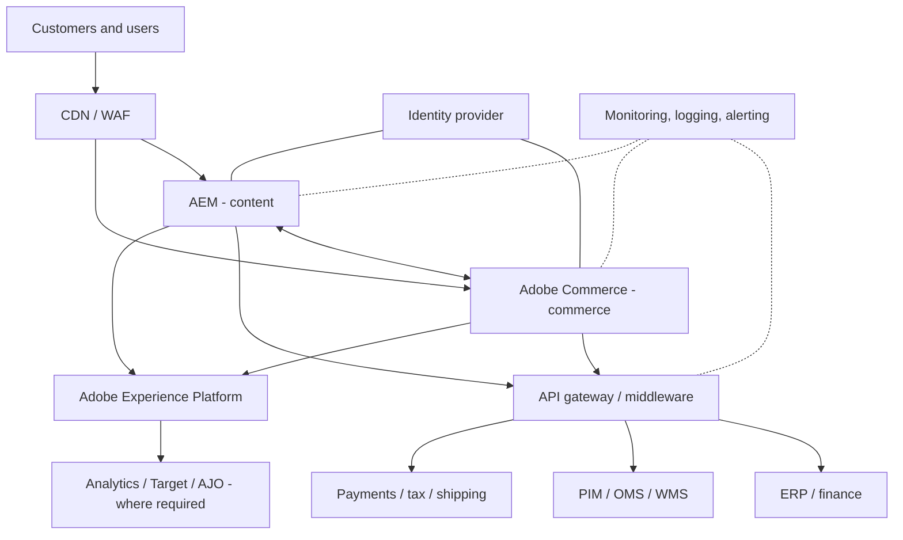
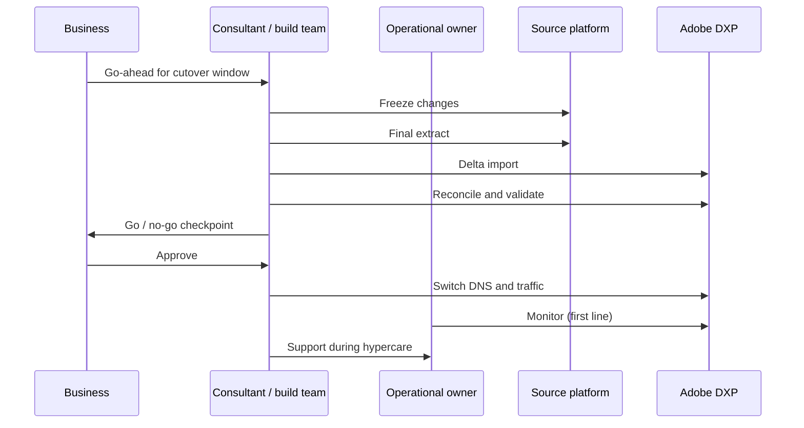

# Reference Diagrams (Mermaid)

> Part of the *Enterprise Adobe DXP Migration Handbook* v1.1 (Review Draft). Section numbers (§) refer to the handbook's original numbering; see the root [README](../README.md) for the section map.

## C.1 Lifecycle and gates

## C.2 Target architecture (illustrative)

## C.3 Cutover sequence

---

**End of Handbook – Version 1.1 Review Draft**
