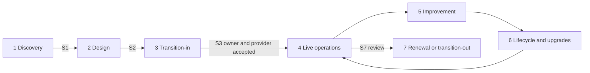
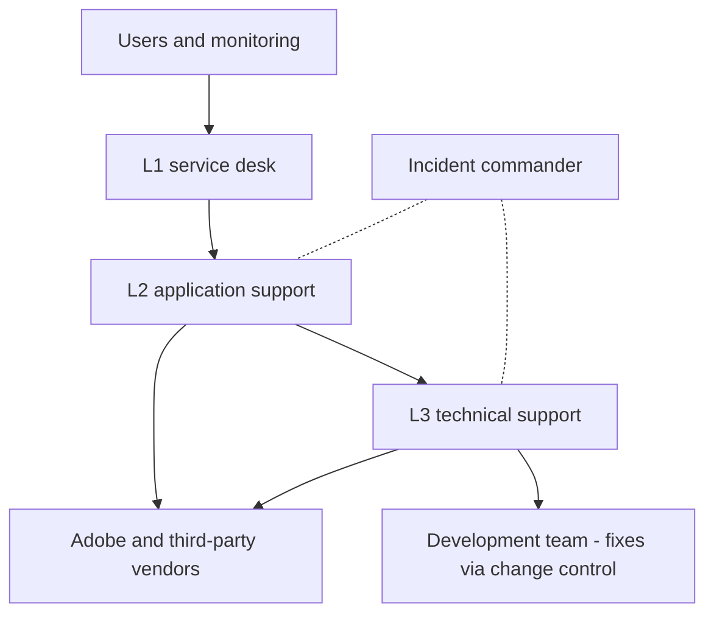
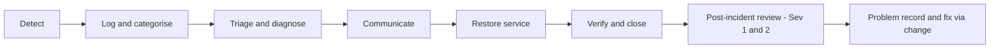

# Reference Diagrams (Mermaid)

> Part of the *Enterprise Adobe DXP Support and Operations Handbook* v1.0 (Review Draft). Section numbers (§) refer to the handbook's original numbering; see the README at the root of this folder for the section map.

## C.1 Service lifecycle and gates

## C.2 Support tiers and escalation

## C.3 Incident flow

---

**End of Handbook – Version 1.0 Review Draft**
